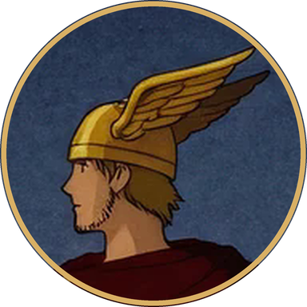
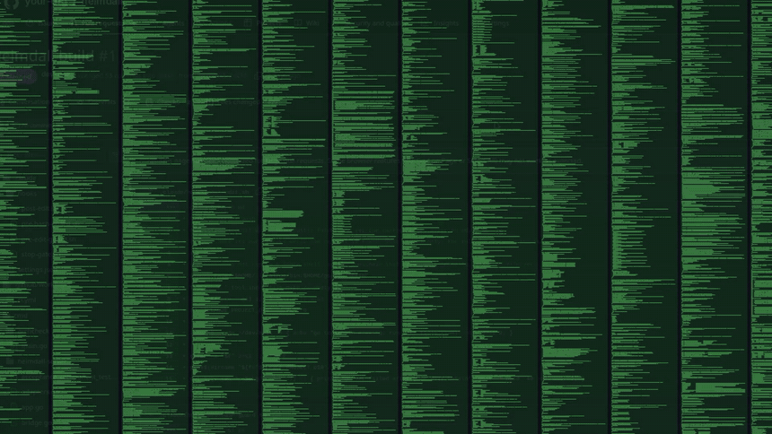
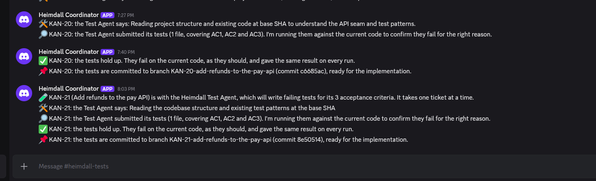
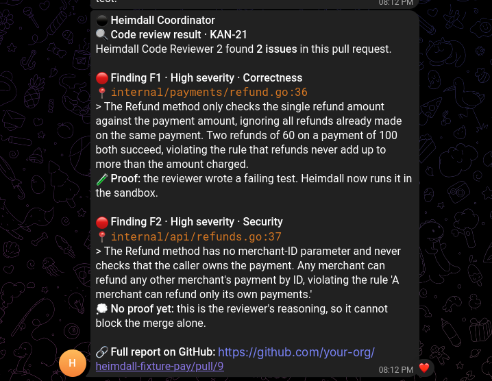
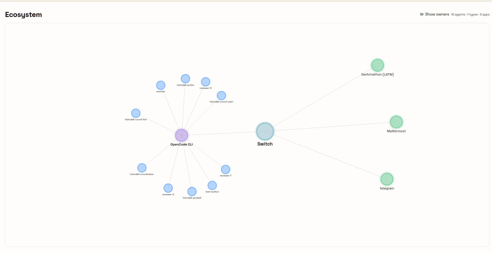
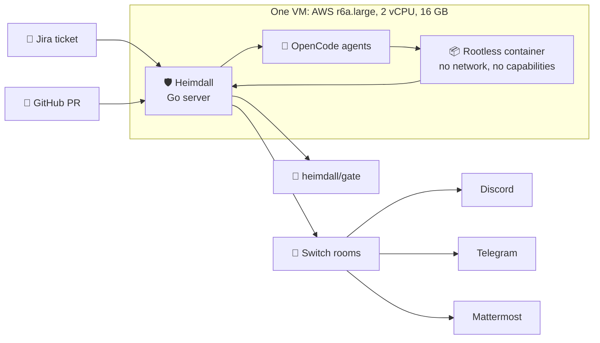
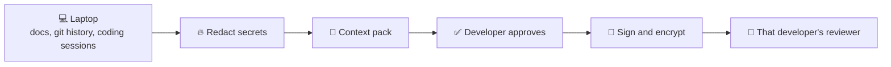

<p align="center">
  
</p>

<p align="center">
  
</p>

<h3 align="center">AI wrote the pull request. Who proved it works?</h3>

<p align="center">
  Reviewers that carry what each developer knows.<br>
  Red tests written from the ticket, before the code.<br>
  A merge gate no model can talk its way past.
</p>

<p align="center">
  
  
  
  
  
</p>

<p align="center">
  <a href="#-see-it-work"><b>See it work</b></a> ·
  <a href="#-how-it-works"><b>How it works</b></a> ·
  <a href="#-why-switch"><b>Why Switch</b></a> ·
  <a href="#-run-it"><b>Run it</b></a> ·
  <a href="#-whats-live-today"><b>What's live</b></a>
</p>

---

## 🌈 The problem

<p align="center">
  
</p>

Agents write most of our code now. Our own build PR was **+77,460 lines across 629 files**. Two things break at that size:

| | What breaks | What Heimdall does |
|---|---|---|
| 👀 **Review** | Nobody can read it, so it gets a quick LGTM | Each reviewer carries one developer's context, and a finding comes with a failing test |
| 🧪 **Testing** | Agents write tests that pass whether the code works or not | Tests come from the ticket, and they must fail first, for the right reason |

## 🎬 See it work

These are real screens from our live runs, with names replaced.

<table>
  <tr>
    <td width="58%"></td>
    <td width="42%" rowspan="2"></td>
  </tr>
  <tr>
    <td></td>
  </tr>
</table>

> **"Two refunds of 60 on a payment of 100 both succeed."**<br>
> A real finding from a Heimdall reviewer, with the failing test it wrote as proof.

## ⚡ How it works



1. **A ticket moves to In Progress.** Heimdall opens a room, creates a branch and wakes the Test Agent.
2. **Red tests first.** The agent writes tests from the ticket. A test that passes before the feature exists is rejected.
3. **Tests are pinned.** Survivors are committed, pinned by tree hash, and run in CI on every pull request.
4. **Independent reviews.** Reviewers can't see each other's work. Findings land on the exact line, on the PR and in chat.
5. **Ten rules decide.** Plain Go, no model in the path. Only a person can approve, and only that exact commit.

### Evidence, not opinion

| Tier | Evidence | Blocks a merge? |
|---|---|---|
| 🧪 E1 | A test that fails on this commit | ✅ |
| 🔧 E2 | A deterministic tool result | ✅ |
| 🧠 E3 | A confirmed fact from team memory | ✅ |
| 💭 E4 | Reasoning | ❌ Never alone |

### Each developer's context



Raw transcripts never leave the laptop. Underneath, a **Graphiti** knowledge graph holds the team's decisions and incidents. This path is built and unit tested, and it is [not live yet](#-whats-live-today).

## 🆚 What's different

| A typical AI review bot | Heimdall |
|---|---|
| Comments on a diff | Gives one developer's context to each reviewer |
| States an opinion | Proves a finding with a failing test |
| Arrives after the code | Writes red tests before the code |
| Suggests a fix | Blocks the merge until the rules hold |

## 🔌 Why Switch

Heimdall stops working without Switch. It provides the rooms, agent identities, chat bridges and shared history.

**Agents connected**, all in OpenCode, each as its own Unix user:

| Agent | Job |
|---|---|
| 🛡️ **Heimdall Coordinator** | Posts progress, reads `heimdall` commands, wakes agents |
| 🧪 **Test Agent** | Writes failing tests from the ticket, and asks people when a rule is unclear |
| 🔎 **Code Reviewers 1 to 3** | Review independently, and file findings with evidence |
| ⚖️ **Resolver** | Handles disputed findings |

**How the channels are set up**

- Each ticket gets a private Switch working room, so an agent keeps one session per ticket.
- `heimdall-tests` and `heimdall-reviews` are public channels, bridged to Discord and Mattermost.
- A Telegram group receives both stories.
- Commands start with the plain word `heimdall`, for example `heimdall answer KAN-17 Q1 ...`. A command counts only if its sender is mapped in `heimdall.yaml`.

Room and bridge settings live in `heimdall.toml`, under `[rooms]` and `[[feeds]]`. See [`deploy/heimdall.example.toml`](deploy/heimdall.example.toml).

## 🏎️ Built small, on purpose

| | |
|---|---|
| 🐹 **All Go** | The server, runner and CLI |
| 🪶 **~42 MiB** | Server memory, idle |
| 🪶 **~10 MB** | Sandbox runner memory, idle |
| 📦 **Locked containers** | `--network=none --read-only --cap-drop=ALL`, with memory and process limits |
| 🖥️ **One small VM** | 2 vCPU, 9 containers, 7 agent units |
| 🚪 **No public ports** | Heimdall polls GitHub and Jira |
| 🔗 **Event sourced** | Hash-chained events and a transactional outbox in Postgres |

Measured on our VM on Nov 7, 2026.

## 🚀 Run it

You need Go 1.27 and Docker.

```bash
make tools
```

```bash
make fast
```

```bash
make verify
```

The full system needs a Linux VM, a Switch server, a GitHub App and a Jira project:

1. [`docs/RUNBOOK.md`](docs/RUNBOOK.md): Switch on the VM, secrets and the server's live run
2. [`docs/COMPANY_SETUP.md`](docs/COMPANY_SETUP.md): connect your company's tools
3. [`deploy/heimdall.example.toml`](deploy/heimdall.example.toml): server configuration
4. [`deploy/agents/README.md`](deploy/agents/README.md): install the agents

The test repository is [`heimdall-fixture-pay`](https://github.com/aarush323/heimdall-fixture-pay), base branch `heimdall-test/demo-base`.

## ✅ What's live today

We keep this list honest. Evidence is in [`docs/PROGRESS.md`](docs/PROGRESS.md).

**Seen working on the real system**

- ✅ Jira ticket to room, branch and agent: room in 0.3 to 2.4 s after pickup, agent acknowledged in 11.5 to 23 s
- ✅ Tests from a ticket, judged red-first in the sandbox, then committed (KAN-14, 16, 17, 19, 20, 21)
- ✅ The judge rejecting bad tests: `passed without the feature on base`
- ✅ Reviewers filing findings with a failing test (KAN-20, KAN-21)
- ✅ Line comments, the Heimdall Review comment, and cards in Discord and Telegram
- ✅ `heimdall/acceptance`, and a red `heimdall/gate` from real events
- ✅ A real human approval read from GitHub, and a Mattermost command recorded
- ✅ GitHub Actions on the fixture

<details>
<summary><b>🚧 Built and tested, not yet seen live</b></summary>

- 🚧 **Context packs:** code and unit tests exist in `internal/pack`. No pack ran on the live server, and the reviewer prompt does not call `read_pack` yet.
- 🚧 **Graphiti memory:** Graphiti and FalkorDB run on the VM, but the graph is empty because delivery is blocked.
- 🚧 **Different context per reviewer:** the three reviewers share one prompt today. The per-developer view is the design.
- 🚧 **Three reviewers finishing one PR:** at most one has finished on a PR so far.
- 🚧 **Heimdall re-running a reviewer's proof:** not seen live.
- 🚧 **A gate red because of a finding, the resolver, a fix push, and a merge from agent events:** not seen live.
- 🚧 **Discord and Telegram commands typed by a person:** not verified.

**Known gaps:** a fake test that imports the product can still pass the judge. A new agent session can time out on first start, and restarting the unit clears it.

</details>

<details>
<summary><b>🗺️ Repository layout</b></summary>

| Path | What it holds |
|---|---|
| `cmd/heimdall-server` | The server |
| `cmd/heimdall-runner` | The sandbox runner |
| `cmd/heimdall` | The CLI: `connect`, `doctor`, `pack`, people mapping |
| `internal/domain` | Pure rules and types, including the gate |
| `internal/app` | Use cases |
| `internal/adapters` | GitHub, Jira, Switch, Postgres, Graphiti, runners |
| `internal/transport` | MCP, dashboard, webhooks |
| `internal/pack` | Context packs |
| `skills/` | Prompts for the test author, reviewer and resolver |
| `deploy/` | Compose stack, service units, config template |
| `docs/` | Design, spec, runbook, progress |
| `site/` | The landing page |

Coding agents start at [`CLAUDE.md`](CLAUDE.md). The design documents were written before the event opened.

</details>

---

<p align="center">
  <br>
  <b>Humans bring judgment. Agents bring proof.</b><br>
  <sub>Built for Flip the Switch, Track 01: Best Business Workflow. Built on <a href="https://github.com/sandbox-quantum/switch">Switch</a>.</sub>
</p>
