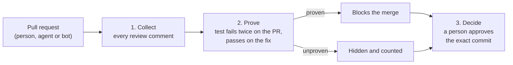

<p align="center">
  <a href="https://heimdall-sage.vercel.app">
    
  </a>
</p>

<h3 align="center">The open-source proof layer for AI-written code.</h3>

<p align="center">
  Heimdall checks every AI review comment against a real test.<br>
  A finding blocks the merge only when the test proves it. A person approves the exact commit.
</p>

<p align="center">
  <a href="https://github.com/prathameshk421/Heimdall/actions/workflows/ci.yml"></a>
  <a href="LICENSE"></a>
  <a href="go.mod"></a>
  <a href="https://heimdall-sage.vercel.app"></a>
  <a href="CONTRIBUTING.md"></a>
</p>

<p align="center">
  <a href="https://heimdall-sage.vercel.app"><b>Website</b></a> ·
  <a href="#quickstart"><b>Quickstart</b></a> ·
  <a href="#how-it-works"><b>How it works</b></a> ·
  <a href="#results-so-far"><b>Results</b></a> ·
  <a href="docs/README.md"><b>Docs</b></a> ·
  <a href="CONTRIBUTING.md"><b>Contribute</b></a>
</p>

---

AI review bots leave many comments, and few of them change the code. Heimdall is a **CI merge gate** that sits after
those bots. It reads every review comment, its own and third-party ones (CodeRabbit, Copilot, Bugbot, Greptile,
Macroscope). Each finding must earn a **failing test** in a sandbox. Proven findings block the merge. Unproven ones are
hidden and counted, so a reviewer sees one real bug instead of twelve opinions.

No model sits in the gate. The gate is plain Go rules, and only a person can approve, on the exact commit SHA.

> [!NOTE]
> **Heimdall is early, and we state its limits.** The GitHub Action and the self-hosted server run on real
> repositories, but proof recall on live models is still low. Every number below links to its source, and
> [`docs/PROGRESS.md`](docs/PROGRESS.md) lists what is **not verified**.

## Highlights

- **Proof, not opinion.** A finding counts only when its test fails twice on the pull request and passes on the fix.
  One red run is not proof, and a build error is not proof.
- **Works with the review bots you already use.** Heimdall ingests their comments and proves or hides each one.
- **Model-free merge gate.** Deterministic Go rules decide. A model cannot talk its way past the gate.
- **Installs in minutes.** GitHub Action mode needs no server and no database. A live install reached its first
  proof summary in **3 min 10 s** ([tracker](docs/product/TRACKER.md)).
- **Shadow mode first.** Checks report what *would* block, and block nothing, until you switch to enforce.
- **Sandboxed test runs.** Untrusted code runs in rootless containers with no network, a read-only filesystem, and
  CPU, memory and process limits.
- **Bring your own model.** Any OpenAI-compatible endpoint, with a per-PR and a monthly cost cap.
- **Small footprint.** One static Go binary. The server idles at about 42 MiB of memory.

## The problem

We read every bot review comment on 30 merged pull requests of an active open-source repository,
[`pingdotgg/t3code`](https://github.com/pingdotgg/t3code). There were **411 comments**, a median of 10 per pull
request. The developer dismissed **95 of 135 Bugbot comments (70%)**.
[Method and limits](https://heimdall-sage.vercel.app/#problem).

| Reviewer | Comments | Code changed after the comment |
|---|---:|---:|
| CodeRabbit | 60 | 29 (48%) |
| Macroscope | 175 | 75 (43%) |
| Bugbot | 135 | 32 (24%) |

A reader cannot tell the real bug from the noise without a check of each comment by hand. Heimdall does that check
with a test.

## How it works



1. **Collect.** Heimdall reads every review comment on the pull request.
2. **Prove.** An agent writes a test for each finding. The test runs in a sandbox, at least twice on the head commit
   and once on a tree with the fix.
3. **Decide.** A proven finding blocks the merge. One summary comment lists the proven findings, the unproven count
   and the cost. A person approves the exact commit SHA.

### Evidence tiers

| Tier | Evidence | Can it block a merge? |
|---|---|---|
| E1 | A test that fails on this commit | Yes |
| E2 | A deterministic tool result | Yes |
| E3 | A confirmed fact from team memory | Yes |
| E4 | Model reasoning | Never alone |

## Two ways to run it

| | **GitHub Action mode** | **Self-hosted team mode** |
|---|---|---|
| For | Any repository on GitHub | Teams that want the full loop from ticket to merge |
| Needs | GitHub Actions and a model key | A Linux VM, PostgreSQL, a GitHub App, Jira and [Switch](https://github.com/sandbox-quantum/switch) |
| Does | Proves review comments on each PR; posts `heimdall/fast`, `heimdall/proof` and one summary | Writes red tests from the Jira ticket before the code, runs independent AI reviewers, and gates the merge |
| Chat | None | Slack, Discord, Telegram, Mattermost (through Switch) |
| Guide | [`deploy/action/README.md`](deploy/action/README.md) | [`docs/SETUP.md`](docs/SETUP.md) |

## Quickstart

### GitHub Action mode (about 10 minutes)

You need admin rights on the repository, the `gh` CLI, Go 1.27, and a key for an OpenAI-compatible model endpoint.

```bash
git clone https://github.com/prathameshk421/Heimdall.git && cd Heimdall
```

```bash
CGO_ENABLED=0 go build -o heimdall ./cmd/heimdall
```

```bash
./heimdall action init -repo OWNER/REPO
```

The last command prints the setup plan and changes nothing. Add `-apply -model-key-stdin < key-file` to apply it. Then
copy the three workflows from [`deploy/action/workflows/`](deploy/action/workflows) and add one line of policy to
`heimdall.yaml`:

```yaml
action: { mode: shadow, budget: { per_pr_usd: 0.50, monthly_usd: 50 } }
```

The full install guide, with the model variables and the pin rules, is in
[`deploy/action/README.md`](deploy/action/README.md).

### Build and test from source

You need **Go 1.27** and **Docker**.

```bash
make tools
```

```bash
make fast
```

`make fast` runs format, vet, the dependency rule, lint and about 5,900 unit tests in under a minute. `make verify` adds
the race detector, component tests, rule self-tests, `govulncheck` and a `gitleaks` scan of the git history. CI runs
`make verify` on every push.

## Results so far

We measure Heimdall on the **Proof Bench**: real bugs and clean changes with known answers, from Go open-source
repositories, `t3code` (TypeScript and Rust) and our own payment fixture. A case is valid only when its test is red
before the fix and green after it. Details and every run: [`docs/sota/BENCH.md`](docs/sota/BENCH.md).

| What | Result | Source |
|---|---|---|
| Valid bench cases | 28 | [BENCH.md](docs/sota/BENCH.md) |
| Best live run | 1 of 3 scored bug cases proven, 0 false positives on 3 clean cases, $2.92 | [BENCH.md](docs/sota/BENCH.md) |
| Latest live run (`t3code`, uncapped) | 0 of 9 bug cases proven, 0 false positives | [BENCH.md](docs/sota/BENCH.md) |
| Action mode install to first summary | 3 min 10 s, live | [TRACKER.md](docs/product/TRACKER.md) |
| Team mode, full story on Slack | Ticket, red tests, 3 reviews, 2 real findings, fix, human approval, green gate, merge | [PROGRESS.md](docs/PROGRESS.md) |

Read the live runs as a sign of life, not a score. Too few cases finished for a recall rate. The false-positive count
is the number we protect first: a gate that blocks good code gets switched off.

## Built to be trusted

- **No model in the gate.** Ten plain Go rules decide the merge. Model output is evidence for a rule, never a vote.
- **Policy from the merge base.** Heimdall reads `heimdall.yaml` at the merge base, so a pull request cannot change
  its own rules.
- **Human approval on the head commit.** An approval counts only from a person who is not the PR author, and only on
  the exact commit.
- **Isolated test runs.** Rootless Podman containers with no network, read-only filesystems, dropped capabilities and
  resource limits.
- **Secrets stay secret.** No command takes a secret as an argument. Secret scans run on the staged diff and the full
  history. Proof artifacts mask secrets.
- **Audit trail.** Hash-chained events and a transactional outbox in PostgreSQL. Team rule cards carry signed
  approvals (DSSE).

## Tech stack

**Go** · **PostgreSQL** (pgx, goose migrations, River job queue) · **GitHub Actions** and the GitHub REST API ·
**Model Context Protocol (MCP)** · **OpenCode** agents · **OpenAI-compatible LLM APIs** (OpenRouter, DeepSeek) ·
**Rootless Podman** and **Docker Compose** · **Knowledge-graph memory** (Graphiti on FalkorDB) · **OIDC** login ·
**age** encryption · **golangci-lint**, **govulncheck**, **gitleaks**, **actionlint**, **zizmor** in CI.

## Repository layout

| Path | What it holds |
|---|---|
| [`cmd/heimdall`](cmd/heimdall) | The CLI, including `heimdall action` ([reference](docs/CLI.md)) |
| [`cmd/heimdall-server`](cmd/heimdall-server) | The self-hosted server |
| [`cmd/heimdall-runner`](cmd/heimdall-runner) | The sandbox runner |
| [`cmd/heimdall-bench`](cmd/heimdall-bench) | The Proof Bench |
| [`internal/domain`](internal/domain) | Pure rules and types, including the gate. No I/O |
| [`internal/app`](internal/app) | Use cases |
| [`internal/adapters`](internal/adapters) | GitHub, Jira, Switch, PostgreSQL, Graphiti, model APIs, runners |
| [`internal/transport`](internal/transport) | MCP, dashboard, webhooks, auth |
| [`skills/`](skills) | Prompts for the test author, reviewers and resolver |
| [`deploy/`](deploy) | The GitHub Action, Compose stack, service units, config templates |
| [`docs/`](docs) | Setup, CLI, spec, runbook, progress, bench ([index](docs/README.md)) |
| [`e2e/`](e2e), [`testdata/`](testdata) | Real-system checks, scenarios and recorded payloads |
| [`site/`](site) | The [landing page](https://heimdall-sage.vercel.app) |

## Documentation

| Guide | For |
|---|---|
| [`deploy/action/README.md`](deploy/action/README.md) | GitHub Action mode install |
| [`docs/SETUP.md`](docs/SETUP.md) | Self-hosted team mode, from VM to first ticket |
| [`docs/CLI.md`](docs/CLI.md) | Every `heimdall` command and chat command |
| [`docs/TECH_SPEC.md`](docs/TECH_SPEC.md) | State machine, evidence, gate, sandbox |
| [`docs/product/ROADMAP.md`](docs/product/ROADMAP.md) | What we build next |
| [`docs/README.md`](docs/README.md) | Every doc, by purpose |

## Contributing

We welcome bug reports, bench cases, adapters and fixes. Start with [`CONTRIBUTING.md`](CONTRIBUTING.md). It covers the
dev setup, the architecture rules, the test policy and the pull request checklist. Good first areas: new Proof Bench
cases, parsers for more review bots, and test runners for more languages.

Please follow the [Code of Conduct](CODE_OF_CONDUCT.md). To report a vulnerability, read [`SECURITY.md`](SECURITY.md)
and do not open a public issue.

## License

Heimdall is licensed under the [Apache License 2.0](LICENSE).

## Acknowledgements

Heimdall started at the Flip the Switch hackathon (Track 01, Best Business Workflow) and runs its team mode on
[Switch](https://github.com/sandbox-quantum/switch). Built by [@prathameshk421](https://github.com/prathameshk421) and
[@aarush323](https://github.com/aarush323).

<p align="center">
  <br>
  <b>Humans bring judgment. Agents bring proof.</b>
</p>
