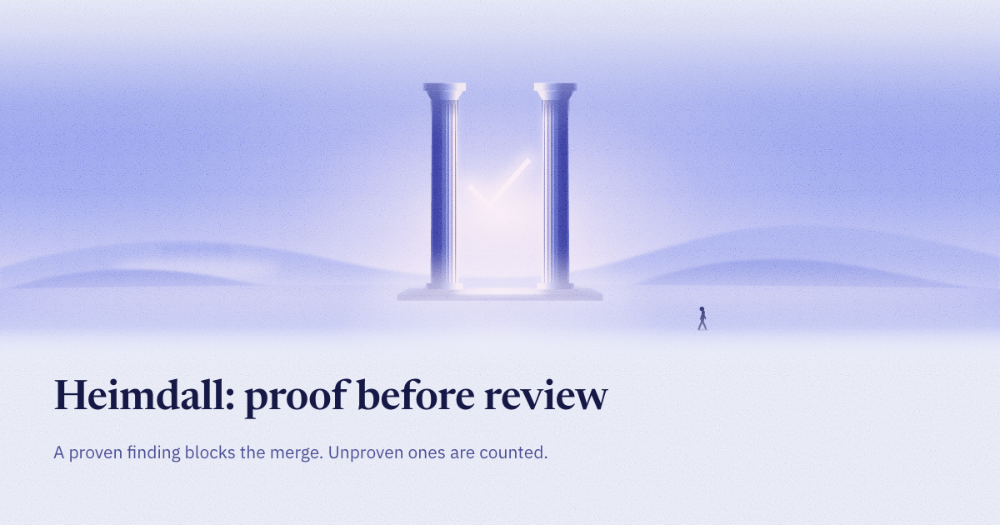
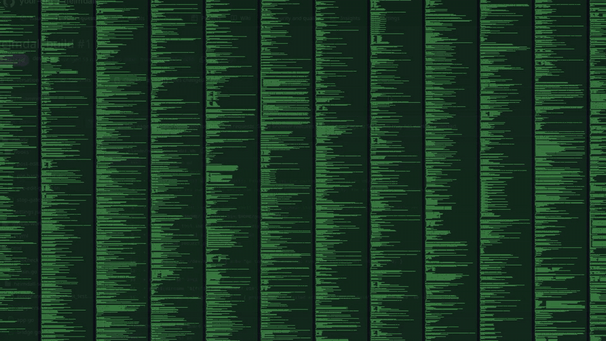
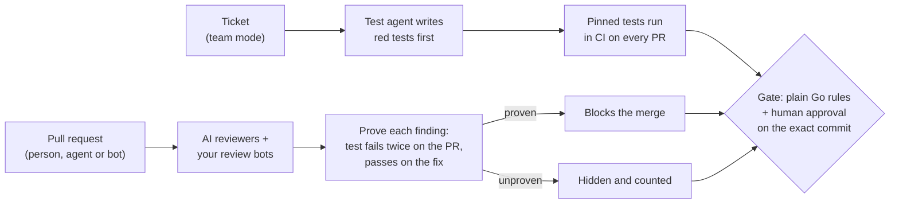

<p align="center">
  <a href="https://heimdall-sage.vercel.app">
    
  </a>
</p>

<h3 align="center">The self-hosted agent harness for high-volume pull request review.</h3>

<p align="center">
  AI agents review every pull request and write the CI tests your code is missing.<br>
  Each finding must earn a failing test before it can block a merge. A person approves the exact commit.
</p>

<p align="center">
  <a href="https://github.com/prathameshk421/Heimdall/actions/workflows/ci.yml"></a>
  <a href="LICENSE"></a>
  <a href="go.mod"></a>
  <a href="#platforms"></a>
  <a href="https://heimdall-sage.vercel.app"></a>
</p>

<p align="center">
  <a href="https://heimdall-sage.vercel.app"><b>Website</b></a> ·
  <a href="https://heimdall-sage.vercel.app/#demo"><b>Demo video</b></a> ·
  <a href="#quickstart"><b>Quickstart</b></a> ·
  <a href="#set-it-up-with-your-coding-agent"><b>Agent skill</b></a> ·
  <a href="#how-it-works"><b>How it works</b></a> ·
  <a href="docs/README.md"><b>Docs</b></a>
</p>

---

Coding agents now write pull requests faster than people can read them. Review bots add more comments, and few of them
point at a real bug. **Heimdall** is an open-source harness that you run on your own infrastructure. It puts AI review
agents on every pull request, turns each finding into a test, and lets only the findings that a test proves reach the
merge decision.

- **Review at volume.** Independent AI reviewers read each change. Heimdall also ingests the comments of the bots you
  already use (CodeRabbit, Copilot, Bugbot, Greptile, Macroscope) and checks them the same way.
- **Real CI tests.** In team mode, an agent writes tests from the ticket before the code exists. A test that passes
  without the feature is rejected. The tests that survive are pinned and run in CI on every pull request.
- **Proof, not opinions.** A finding counts only when its test fails twice on the pull request and passes on the fix.
  Unproven findings are hidden and counted, so a reviewer reads one real bug instead of twelve guesses.
- **A gate no model can talk past.** Plain Go rules decide the merge. Only a person can approve, on the exact commit.

## Quickstart

GitHub Action mode runs inside your repository's own CI: no server, no database. You need admin rights on the
repository, the [`gh` CLI](https://cli.github.com), [Go 1.27](https://go.dev/dl/), and a key for an OpenAI-compatible
model endpoint (OpenRouter by default).

**1. Build the CLI** (Linux, macOS or Windows):

```bash
git clone https://github.com/prathameshk421/Heimdall.git && cd Heimdall && CGO_ENABLED=0 go build -o heimdall ./cmd/heimdall
```

**2. See the plan** for your repository. This changes nothing:

```bash
./heimdall action init -repo OWNER/REPO -dir PATH/TO/YOUR/CHECKOUT
```

**3. Apply it.** This creates the GitHub environment and secrets, sets the model, and writes three workflows (pinned
to the exact Heimdall commit you built) and a shadow-mode `heimdall.yaml` into your checkout:

```bash
./heimdall action init -repo OWNER/REPO -dir PATH/TO/YOUR/CHECKOUT -apply -model-key-stdin < PATH/TO/KEY_FILE
```

**4. Merge the files** in your checkout through your normal review. Open any pull request: Heimdall posts
`heimdall/fast`, `heimdall/proof` and one summary comment. Shadow mode blocks nothing. It shows what *would* block.

On our test repository, `init -apply` took 9 s, and a full install reached its first proof summary in
**3 min 10 s** ([tracker](docs/product/TRACKER.md)). Options, another model and enforce mode:
[`deploy/action/README.md`](deploy/action/README.md).

## Set it up with your coding agent

Heimdall ships a setup skill for coding agents such as Claude Code. It walks the agent through both modes, runs every
check, and never handles your secrets.

```bash
./heimdall skill install
```

Then ask your agent: *"Set up Heimdall on OWNER/REPO."* The skill is in
[`skills/heimdall-setup/SKILL.md`](skills/heimdall-setup/SKILL.md). For other agents, print it with
`./heimdall skill` or pass `-dir` with your agent's skills folder.

## Demo

[](https://heimdall-sage.vercel.app/#demo)

A ticket becomes red tests, three independent reviewers find a real double-refund bug, a person types
`heimdall uphold` in Slack, and the gate turns green only after the fix and a human approval.
[Watch it (2 min 39 s)](https://heimdall-sage.vercel.app/#demo).

## How it works



### Evidence tiers

| Tier | Evidence | Can it block a merge? |
|---|---|---|
| E1 | A test that fails on this commit | Yes |
| E2 | A deterministic tool result | Yes |
| E3 | A confirmed fact from team memory | Yes |
| E4 | Model reasoning | Never alone |

### Two ways to run it

| | **GitHub Action mode** | **Team mode** (self-hosted) |
|---|---|---|
| Runs in | Your repository's GitHub Actions | Your Linux server |
| You need | Admin on the repo, a model key | Docker, PostgreSQL, a GitHub App, a model key. Jira and chat are optional |
| It does | Reviews and proves findings on each PR, posts two checks and one summary | The full loop: red tests from the Jira ticket, independent reviewers, chat commands, the merge gate |
| Chat | None | Slack, Discord, Telegram, Mattermost, Teams (through [Switch](https://github.com/sandbox-quantum/switch)) |
| Guide | [`deploy/action/README.md`](deploy/action/README.md) | [`docs/SETUP.md`](docs/SETUP.md) |

## The problem, in numbers

We read every bot review comment on 30 merged pull requests of an active open-source repository,
[`pingdotgg/t3code`](https://github.com/pingdotgg/t3code). There were **411 comments**, a median of 10 per pull
request. The developer dismissed **95 of 135 Bugbot comments (70%)**.
[Method](docs/product/research/13-t3code-bot-comments.md).

| Reviewer | Comments | Code changed after the comment |
|---|---:|---:|
| CodeRabbit | 60 | 29 (48%) |
| Macroscope | 175 | 75 (43%) |
| Bugbot | 135 | 32 (24%) |

## Results so far

| What | Result | Source |
|---|---|---|
| False blocks on clean changes | **0**, in every live Proof Bench run | [BENCH.md](docs/sota/BENCH.md) |
| Prompt injection planted in a pull request | Never got through | [BENCH.md](docs/sota/BENCH.md) |
| Sandbox escape attempts by code under test | **70 of 70 blocked** (34 network, 36 exec) | [spike report](docs/product/design/ACTION_MODE_SPIKE.md) |
| GitHub Action, install to first summary | **3 min 10 s**, live | [TRACKER.md](docs/product/TRACKER.md) |
| Team mode, end to end on Slack | Ticket, red tests, 3 reviews, 2 real findings, fix, human approval, green gate, merge | [PROGRESS.md](docs/PROGRESS.md) |
| Proof Bench | 28 validated cases: real bugs and clean changes in Go, TypeScript and Rust | [BENCH.md](docs/sota/BENCH.md) |

The **Proof Bench** uses real bugs and clean changes with known answers. A case is valid only when its test is red
before the fix and green after it.

## Built to be trusted

- **No model in the gate.** Plain Go rules decide the merge. Model output is evidence for a rule, never a vote.
- **Policy from the merge base.** A pull request cannot change the rules that judge it.
- **Human approval on the head commit,** from a person who is not the author.
- **Isolated test runs.** Rootless containers with no network, a read-only filesystem, dropped capabilities, and CPU,
  memory and process limits.
- **Secrets stay secret.** No command takes a secret as an argument. Secret scans run on every commit and on the full
  history. Proof artifacts mask secrets.
- **Bring your own model** through any OpenAI-compatible endpoint, with a per-PR and a monthly cost cap.
- **Audit trail.** Hash-chained events in PostgreSQL. Team rule cards carry signed approvals (DSSE).

## Platforms

| Part | Linux | macOS | Windows |
|---|:---:|:---:|:---:|
| `heimdall` CLI: GitHub Action setup, agent skill, digest | ✓ | ✓ | ✓ |
| `heimdall` CLI: team-mode operator commands (`admin`, `connect`, `doctor`) | ✓ | ✓ | WSL2 |
| Server and proof sandbox | ✓ | | WSL2 |
| Building and testing this repository (`make verify`) | ✓ | ✓ | WSL2 |

CI builds every binary for Linux, macOS and Windows (amd64 and arm64) and runs the tests on all three systems. The
team-mode commands manage Unix owner-only secret files, so on Windows use WSL2.

## Tech stack

**Go** · **PostgreSQL** (pgx, goose migrations, River job queue) · **GitHub Actions** and the GitHub REST API ·
**Model Context Protocol (MCP)** · **OpenCode** agents · **OpenAI-compatible LLM APIs** · **Rootless Podman** and
**Docker Compose** · **Knowledge-graph memory** (Graphiti on FalkorDB) · **OIDC** login · **age** encryption ·
**golangci-lint**, **govulncheck**, **gitleaks**, **actionlint**, **zizmor** in CI.

## Repository layout

| Path | What it holds |
|---|---|
| [`cmd/heimdall`](cmd/heimdall) | The CLI ([reference](docs/CLI.md)) |
| [`cmd/heimdall-server`](cmd/heimdall-server), [`cmd/heimdall-runner`](cmd/heimdall-runner) | The team-mode server and the sandbox runner |
| [`cmd/heimdall-bench`](cmd/heimdall-bench) | The Proof Bench |
| [`internal/domain`](internal/domain) | Pure rules and types, including the gate. No I/O |
| [`internal/app`](internal/app), [`internal/adapters`](internal/adapters), [`internal/transport`](internal/transport) | Use cases; GitHub, Jira, Switch, PostgreSQL and model adapters; MCP, dashboard and webhooks |
| [`skills/`](skills) | The agents' instructions, and the setup skill |
| [`deploy/`](deploy) | The GitHub Action, Compose stack, service units, config templates |
| [`docs/`](docs) | Setup, CLI, spec, runbook, progress, bench ([index](docs/README.md)) |
| [`e2e/`](e2e), [`testdata/`](testdata) | Real-system checks, scenarios and recorded payloads |
| [`site/`](site) | The [website](https://heimdall-sage.vercel.app) |

## Contributing

We welcome bug reports, bench cases, adapters and fixes. Start with [`CONTRIBUTING.md`](CONTRIBUTING.md): setup, the
checks, the architecture rules and the pull request checklist. Good first areas: new Proof Bench cases, parsers for more
review bots, and test runners for more languages.

Please follow the [Code of Conduct](CODE_OF_CONDUCT.md). To report a vulnerability, read [`SECURITY.md`](SECURITY.md).
Do not open a public issue for it.

## License

[MIT](LICENSE).

## Acknowledgements

Heimdall started at the Flip the Switch hackathon and runs its team mode on
[Switch](https://github.com/sandbox-quantum/switch). Built by [@prathameshk421](https://github.com/prathameshk421) and
[@aarush323](https://github.com/aarush323).

<p align="center">
  <br>
  <b>Humans bring judgment. Agents bring proof.</b>
</p>
