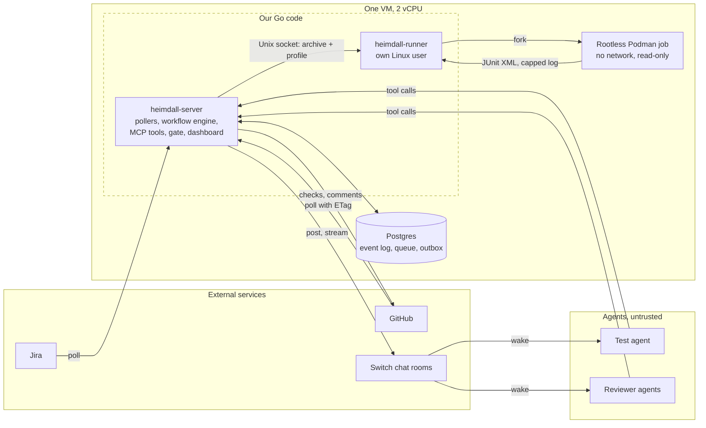
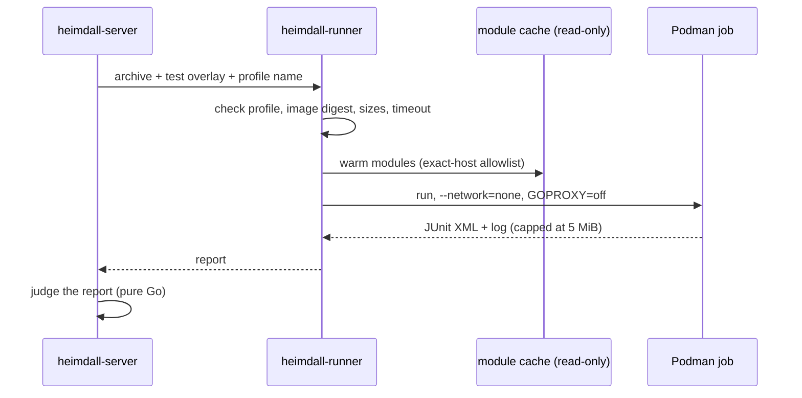

# Trust nothing the model writes: building Heimdall's harness and sandbox in Go

Heimdall is a merge gate for code that AI agents help write. Agents write tests and review pull requests. Plain code decides if a change can merge.

This post is not about the agents. It is about the Go backend behind them: the high-level design, the low-level decisions inside the code, how we kept it light enough for one small VM, and how we verified it. We built it in four days. A large part of that time went into checks that keep the code small and readable, and we think those checks are the most useful part to share.

## Starting point: model output is untrusted input

Early on, we decided that an agent can suggest things, but only plain code can accept them. So every output from a model is untrusted input: a test file, a review finding, and the JUnit report from a test run that an agent wrote.

That decision gave us three requirements for the backend:

- it must run untrusted code somewhere that cannot do harm,
- it must judge results without a model in the loop,
- and the code that judges must be small, strict and easy to test.

The rest of this post follows from those three points.

I always wanted to try Go with agentic workflows, and this project was the best chance to do it. So the main Heimdall server, and the tooling around it, are in Go. But that wish was only one of the factors. For this workload, Go was also one of the best choices we could make, for the reasons below.

## Why Go, and why not TypeScript or Python

We considered three languages. Each was a real candidate.

**TypeScript** was the obvious choice for a hackathon. Most agent tooling has a TypeScript SDK. But our server is not a web app. It is a set of long-running loops: a Jira poller, a GitHub poller, a chat event stream, workers that send side effects, and a timer loop for deadlines. On Node, all of them share one event loop. One slow parse of a large report blocks every other loop. We did not want to design around that.

**Python** has the best AI libraries, but we did not need them. Our agents run in a separate runtime, not in our process. Our process needs concurrency, strict parsing and a simple deploy. Python gives us the GIL, a virtualenv on the server, and loose parsing by default.

**Go** matched the shape of the work:

- **One static binary per program.** We build with `CGO_ENABLED=0` and `-ldflags='-s -w'`. A deploy is a file copy and a `systemctl restart`.
- **Goroutines for the loops.** Each poller, stream and worker is a goroutine with an owner and a stop condition. They share one Postgres pool.
- **A strict standard library.** We decode JSON with unknown fields, duplicate keys and trailing data refused, and we did not need a large dependency tree for that.
- **Good static analysis.** Go's tooling made it cheap to turn our coding rules into lint rules. This turned out to be the most important reason, as we explain below.

The cost is verbosity. Our repository has about 115,000 lines of Go, tests included.

## High-level design

The backend has two programs and one database.



**`heimdall-server`** is one process. It polls Jira and GitHub, reads the Switch event stream, runs the workflow engine, serves the tools that agents call, evaluates the merge gate and renders the dashboard. Agents never touch GitHub, Postgres or the sandbox directly. They call tools on the server, and the server decides what to do with each call.

**`heimdall-runner`** runs untrusted code. It is a separate program under its own Linux user. The server talks to it over a Unix socket.

**Postgres** holds all state: the event log, the job queue, the outbox and the read cursors.

Three decisions shaped this layout.

**One process for the server, not services.** Every loop in the server needs the same event log and the same connection pool. Splitting them into services would add network calls, deploys and failure modes, and we would gain nothing on one VM.

**A separate process for the sandbox.** The server holds the GitHub token, the Jira token and the database connection. If a container escape happened, we wanted the attacker to land in a process that holds none of them.

**Polling, not webhooks.** Webhooks need a public HTTPS endpoint, and our VM has none. We poll GitHub with ETags, so an unchanged resource returns 304 and costs almost nothing. The cost is delay: we poll Jira every 15 seconds and pull requests every 10 seconds.

## Keeping it light

We measured the resident memory of our two processes with `ps` on the VM:

| Process | Memory |
|---|---|
| `heimdall-server`, idle (an earlier check) | 41.8 MiB |
| `heimdall-server`, during live work on Nov 7 | 63.9 MiB |
| `heimdall-runner` | 10.7 MiB |

We did not tune the garbage collector. There is no `GOMEMLIMIT` and no `GOGC` setting, so these are Go's defaults. A small Go service often uses 10 to 30 MiB, so our number is good but not unusual. It also covers only our code. Postgres and the agent runtime use much more.

These choices keep the number small:

- **Postgres is the only stateful service.** The job queue is River, which stores jobs in Postgres. There is no Redis and no Kafka.
- **The dashboard is HTML rendered by the server**, embedded in the binary with `go:embed`. There is no second server and no frontend build.
- **Every reader has a limit.** A JUnit report over 8 MiB is refused before it is parsed. A failure message is cut at 2 KiB. Job logs stop at 5 MiB. A reader stops at its limit and does not buffer an endless stream, so junk input does not grow memory.
- **About 16 direct dependencies.** No web framework and no ORM.

## Low-level design decisions

**Layers.** `domain` holds pure types and rules. `app` holds use cases and imports only `domain` and `ports`. `adapters` implement the ports for Postgres, GitHub, Jira, Switch and the runner. `transport` serves HTTP. `depguard` and a small Go program, `archcheck`, enforce this direction on every run: 82 packages, no violations. The domain may import only an explicit list of standard packages, so `os`, `net`, `log` and randomness are out.

**No clock and no ids in the domain.** Time and ids come in through ports, and `forbidigo` bans `time.Now` and `time.Sleep`. Tests use a fake clock, so nothing waits.

**Strict types.** Ids are distinct types with constructors that validate. Decoding refuses unknown fields, duplicate keys and trailing data. This found a mismatch on the first live connection: Switch sends `2.0` where we expected an integer.

**One decision, one append.** Every state change is an event appended at an expected version. Every side effect is an outbox row written in the same transaction. On a version conflict, the engine loads the change again and decides again, up to five times. Outbox effects have idempotency keys, back off on failure and go to a dead-letter state after eight attempts. The cost: one illegal event in one history once stopped the replay, and with it the timers for every change.

**Pure judges.** The merge gate and the test judge are pure functions of values. A fact that is not known counts as unmet. A test counts only if it fails on the base commit for a real reason, not a compile error. We test both with plain values, in milliseconds.

## The sandbox

The runner accepts a narrow contract:

- **The caller picks a profile, not a command.** Profiles are fixed when the runner starts.
- **An image must be pinned by its sha256 digest.** A tag is refused.
- **The timeout must be between 1 and 600 seconds.**

Each job is a fresh rootless Podman container:

```
--network=none --read-only --user=65532:65532
--cap-drop=ALL --security-opt=no-new-privileges
--pids-limit=512 --memory=2g --cpus=2
--tmpfs /work:size=512m   --tmpfs /tmp:size=64m   --tmpfs /out:noexec,size=8m
--mount src.tgz,ro   --mount module-cache,ro
```



We chose rootless Podman over Docker because Docker needs a daemon that runs as root. We wanted an unprivileged user that forks a container, waits and exits. The job has no network, so a separate warm step fills a read-only module cache through an exact-host allowlist, and the job runs with `GOPROXY=off`.

That choice cost us more time than any other. Each systemd hardening option we added broke the runtime in a way we did not expect:

| Unit option | What broke | Fix |
|---|---|---|
| Socket group as the primary group | `newuidmap` refused the process | Keep the user's own group; re-group the socket after start |
| `NoNewPrivileges=true` | The setuid helpers lost their bit: `write to uid_map failed` | Off; `RestrictSUIDSGID=true` kept |
| runc with resource limits | Could not create the cgroup | Install `crun`; deploy refuses without it |
| `/tmp` at 64 MiB | A cold Go build ran out of space | Build cache on the 512 MiB `/work` tmpfs |
| `ProtectKernelTunables=true` | Every job saw `/proc/sys` read-only after a restart | Off; the runner is not root |
| `RestrictAddressFamilies` | Tests that start a local HTTP server panicked | Allow `AF_INET` and `AF_INET6`; unit IP access only to localhost |

Each option is good advice on its own. Together, under a rootless container runtime, they interact in ways that no single document describes. We now add one option at a time and run a real job after each.

## How we verified it

This is the part we spent the most effort on. Much of the code was written with coding agents, and agent-written code has a typical shape: long functions, deep nesting, a global client "for now", and a `time.Sleep` to wait for something. We did not want to catch that in review. We wanted the build to refuse it.

### Checks in layers

| Command | What it runs | Time |
|---|---|---|
| `make fast` | `gofmt`, `go vet`, `archcheck`, `golangci-lint`, unit and contract tests | About 60 s for about 4,000 tests |
| `make verify` | `make fast`, plus the race detector, component tests on a real Postgres in Docker, the lint self-test, hook tests, `govulncheck`, `gitleaks` | Before each commit that ends a task |
| `make e2e` | One task against the real systems | When the task needs it |

`make fast` also runs in the git pre-commit hook. A skipped test fails the run.

### The lint rules that mattered

We enable 24 linters. Most are standard (`errcheck`, `staticcheck`, `gosec`, `errorlint`, `bodyclose`, `contextcheck`). These are the ones that changed how we wrote code:

| Linter | Our setting | Why |
|---|---|---|
| `gocyclo` | Cyclomatic complexity at most 12 | A function with more paths than that cannot be covered by a short table test |
| `funlen` | At most 60 lines and 40 statements | A function that needs comments to explain its sections should be split |
| `depguard` | Strict allowlists per layer | The dependency rule, checked on each run |
| `forbidigo` | Bans `time.Sleep`, `time.Now`, `fmt.Print*`, `os.Getenv`, `panic` | The clock, output, config and errors each go through one place |
| `gochecknoglobals`, `gochecknoinits` | No package-level variables, no `init()` | All wiring happens in `cmd/` and is passed in |
| `nolintlint` | A `//nolint` needs a linter name and a reason | No silent exceptions |
| `exhaustive` | Every `switch` on an enum covers every value | A new state or event type cannot be missed |

### Why cyclomatic complexity

We picked complexity and length limits for a specific reason. The parts that decide merges must be readable by a person in one sitting. A function with complexity 12 has at most 12 independent paths. That is a table test with about 12 rows, which a reviewer can read and check. A function with complexity 30 usually has paths that no test reaches.

The limit fires often. On Nov 7, while we wrote this post, it flagged two functions in unfinished work:

- `assembleMCP`, the function that wires the tool server, was 64 lines. We moved the task adapter setup into `newTasksAdapter`.
- `config.build` had complexity 15. We moved the checks for the secrets directory, the cards directory and the listen address into `addPaths`.

Both fixes are small, and neither changes behavior. That is typical. Most violations are in wiring code, where a function grows by one more `if err != nil` at a time.

There is a cost. Splitting a function only to satisfy a linter can scatter logic that reads better in one place. We accept it, because the alternative is review by eye on code that agents write faster than people read. We do not raise the limit for a single function. If a function really needs to be long, we want that discussion in the commit.

### Testing the linter

A lint rule can stop working without anyone noticing: a config change, a new linter version, a path pattern that no longer matches. So we test the linter. `make lint-selftest` lints 40 fixture files in `testdata/lint/bad`, one per rule, and fails unless each one is flagged. A matching set in `testdata/lint/good` must stay clean.

### Other tests

- **Table tests** for every reducer cell and every gate clause.
- **Fuzz tests** for the parsers that read untrusted input, in 14 test files: event payloads, the hash chain, chat commands, ids, policy files and Jira's document format. Each checks that the parser never panics on any input. The payload fuzz test also checks that a decoded value encodes back to the same form.
- **Component tests** against a real Postgres started by testcontainers. Migrations are forward-only and tested the same way.
- **The race detector** over the full suite, about 4,000 tests.

### Rules that hold under agents

Prose rules are forgotten under pressure, and an agent that loses context forgets them first. So we placed each rule at the cheapest point that can enforce it:

- A hook runs `go vet` on a package right after each edit.
- A hook refuses shell commands that read secret paths, skip git hooks or rewrite history.
- Changes to the lint config and the test scenarios need a human's approval.
- A stop hook does not let an agent end its turn while `make fast` is red.

The hooks are short shell scripts, and their own tests run in `make verify`. The checks they call are the Go tools above. We kept one rule for all of this: a rule that is broken twice becomes a check, with a fixture that proves it fires.

## Connecting the backend to Switch

Switch is where the agents and the humans meet. Heimdall posts to rooms and reads a stream of room events. These are the backend points to check first if you connect a server to Switch:

- **The client creates the `connection_id`.** Switch refuses an event stream without one (HTTP 400). Make a UUID once, send it as a query parameter and reuse it on each reconnect.
- **`heartbeat_interval_seconds` is a float.** Switch sends `2.0`.
- **Switch has a refusal breaker.** Eight identical refusals by one caller on one path within 120 seconds block that path with HTTP 429 for 60 seconds, and the block doubles up to 15 minutes. All our posts used one path. A retry loop that posted into a deleted room silenced all of our chat for about 16 minutes. Treat retries as load.
- **Do not delete a room under an open stream.** Switch then refused our whole event stream with 403. The server now probes a refused room and marks it as gone.
- **One private room per ticket.** Each agent keeps one session per room. With shared rooms, one session covered many tickets and mixed them up.

We found each of these on the live system, and we checked the facts against Switch's source code.

## The decisions in one table

| Decision | Options we considered | What we chose | What it cost |
|---|---|---|---|
| Language | TypeScript, Python, Go | Go | Verbose code; about 115,000 lines |
| Process layout | Services, one process | One server process plus a separate runner | One process to restart for any change |
| Where untrusted code runs | Inside the server, separate process | Separate runner, own user, Unix socket | A second unit and a socket contract to maintain |
| Container runtime | Docker, rootless Podman | Rootless Podman with crun | Six systemd problems found live |
| How we get events | Webhooks, polling | Polling with ETags | A polling delay, but no public endpoint |
| State | Postgres plus Redis or Kafka, Postgres only | Postgres only | Queue throughput limited by one database |
| State changes | Update rows, append events | Events with versions, plus an outbox | Replay can stop on one bad event |
| Structure | Simple packages, ports and adapters | Ports and adapters, checked by lint | More files per feature |
| Code size | Review by eye, hard limits | Complexity 12, 60 lines, checked by lint | Some logic split only to pass the limit |

## What we would do differently

- **Add hardening one option at a time.** Most of our sandbox time went into the interaction of systemd options with rootless Podman.
- **Use fewer layers where nothing decides.** Ports and adapters paid off in the gate and the judge. In the chat narrator and the dashboard, it was more ceremony than value.
- **Check replay safety when an event arrives.** An event that the state machine refuses should never reach the log.

## Where it stands

On the live system, the backend ran the test flow end to end: ticket, room, tests, sandbox, verdict, commit. All of it ran on one VM with 2 vCPUs, with the server at about 64 MiB under load and the runner at about 11 MiB.

Go was a good fit for this kind of server. Most of our lost time came from the environment, not the language: systemd options, the container runtime and Switch's rate limits. The checks were the part that saved the most time. They caught problems at the point where they were cheapest to fix.
